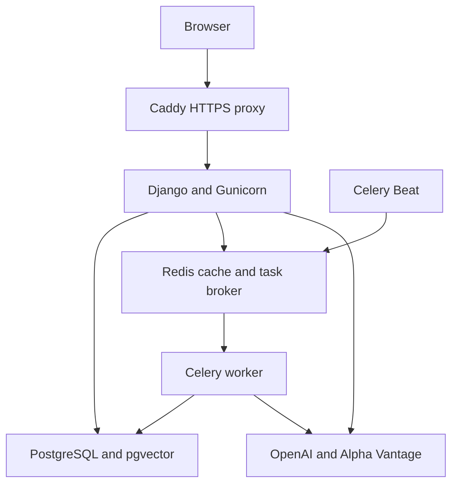

# InvestMind AI

InvestMind AI is an investment portfolio analysis application built with Django,
PostgreSQL and a controlled AI explanation layer. It combines portfolio and
transaction management, deterministic analytics, market data integration,
background processing and retrieval-augmented generation (RAG).

The current implementation includes a containerized development environment,
automated CI checks, private image publication and a working AWS demonstration
deployment. Deployment is initiated from the operator's Mac; image publication
does not automatically update or start the AWS instance.

## Features

- Portfolio, asset, position and buy/sell transaction management.
- Portfolio composition, concentration, performance, risk, attribution and
  diversification analytics, subject to data availability.
- Alpha Vantage integration for market quotes and historical prices.
- Redis caching and Celery background tasks, including asynchronous AI reports.
- Structured AI reports with saved context and automated evaluation results.
- Persistent AI conversations with allowlisted, read-only portfolio tools.
- Financial knowledge retrieval using OpenAI embeddings and PostgreSQL/pgvector.
- Django REST Framework APIs with JWT and session authentication, plus web pages.
- PostgreSQL backups with isolated local restoration tests.

Python calculates financial metrics. The AI layer explains backend results and
retrieved reference material. Missing analytics remain explicitly unavailable.

## Technology stack

| Area | Components |
| --- | --- |
| Application | Python 3.14, Django 6.1, Django REST Framework |
| Data | PostgreSQL 18, pgvector, Redis |
| Background processing | Celery worker and Celery Beat |
| External providers | Alpha Vantage and OpenAI |
| Production runtime | Gunicorn, WhiteNoise and Caddy |
| Packaging | Docker and Docker Compose |
| Cloud infrastructure | AWS EC2 ARM64, Terraform and Ansible |
| Delivery | GitHub Actions and GitHub Container Registry (GHCR) |

Dependency versions are defined in the requirements files. The published demo
application image targets `linux/arm64`.

## Runtime architecture



PostgreSQL and Redis use persistent Docker volumes and have no public host ports
in the AWS deployment. Caddy exposes the HTTP/HTTPS entry point.

## Local development

### Prerequisites

- Docker Desktop with Docker Compose running on the Mac.
- Git and Python 3 for local helper scripts.
- Access to this repository.

Run the following commands from the repository root. The application dependencies
are installed inside the Docker image; a host Python virtual environment is not
required to run Django through Compose.

### Configure the local environment

Create `.env` only if it does not already exist. This command generates local
credentials without printing them and creates the file with permissions `0600`:

```bash
python3 - <<'PY'
import os
import secrets
from pathlib import Path

path = Path('.env')
if path.exists():
    raise SystemExit('Existing .env preserved. Review its configuration instead.')

values = {
    'DJANGO_SECRET_KEY': secrets.token_urlsafe(64),
    'DJANGO_DEBUG': 'true',
    'DJANGO_ALLOWED_HOSTS': '127.0.0.1,localhost',
    'POSTGRES_DB': 'investmind',
    'POSTGRES_USER': 'investmind',
    'POSTGRES_PASSWORD': secrets.token_urlsafe(36),
    'POSTGRES_HOST': 'db',
    'POSTGRES_PORT': '5432',
    'REDIS_URL': 'redis://redis:6379/1',
    'CELERY_BROKER_URL': 'redis://redis:6379/2',
    'OPENAI_API_KEY': '',
    'ALPHA_VANTAGE_API_KEY': '',
}
descriptor = os.open(path, os.O_WRONLY | os.O_CREAT | os.O_EXCL, 0o600)
with os.fdopen(descriptor, 'w', encoding='utf-8') as output:
    output.write(''.join(f'{key}={value}\n' for key, value in values.items()))
print('Created private local .env.')
PY
```

For an existing PostgreSQL volume, retain its original database credentials.
Changing `.env` does not change the password already stored in PostgreSQL.
Add valid provider keys privately when testing live market data or AI features.
The environment file is excluded from Git and the image build context.

### Build and start the services

```bash
docker compose config --quiet
docker compose build web
docker compose up -d --wait db redis
docker compose run --rm web python manage.py migrate
docker compose up -d web worker beat
docker compose ps
docker compose exec web python manage.py createsuperuser
```

Open [the local application](http://127.0.0.1:8000/) or
[Django administration](http://127.0.0.1:8000/admin/). A newly initialized database
does not contain the AWS demo records. Register assets through the admin before
selecting them in transaction forms.

Optional knowledge-base ingestion requires a configured OpenAI key and makes
external API calls:

```bash
docker compose exec web python manage.py ingest_knowledge_base
```

### Run checks and tests

```bash
docker compose run --rm web python manage.py check
docker compose run --rm web python manage.py test
python3 -m unittest discover -s scripts/tests -p 'test_*.py' -v
```

The Django test runner creates a separate test database. Infrastructure helper
tests use simulated external operations. Live AWS/provider checks are separate
from the automated test suite.

### Stop local services

```bash
docker compose stop
```

Persistent volumes remain available. Avoid volume removal when retaining local
data. Stopping local containers does not stop an AWS EC2 instance.

## Delivery and AWS operation

Pull requests run the CI checks. Successful eligible pushes to `develop` or
`main` also publish a production ARM64 image to the private GHCR package and
produce release metadata. The registry deployment script validates the selected
commit and digest, verifies the AWS target, and invokes Ansible from the Mac.

The AWS environment is a single Ubuntu EC2 demo host. Terraform defines the
resources; Ansible prepares the host and deploys Docker services. The public IP
can change after a stop/start cycle. The operating guide covers access updates,
host-key verification, deployment, backup and shutdown.

## Documentation

| Guide | Purpose |
| --- | --- |
| [AI architecture](docs/ai-architecture.md) | Analytics, reports, tool calling, conversations and RAG |
| [Local production verification](docs/production-local.md) | Gunicorn, static assets and production settings on loopback |
| [AWS demo operations](docs/aws-demo-operations.md) | Routine startup, access, deployment and shutdown |
| [Registry delivery](docs/registry-delivery.md) | CI publication, release selection and private image deployment |
| [Archive deployment](docs/aws-demo-deploy.md) | Alternative image build and SSH transfer from the Mac |
| [Backup and restore verification](docs/aws-demo-backup.md) | Database export and isolated restoration tests |
| [Functional validation](docs/functional-validation-review.md) | Recorded results, calculation conventions and limitations |
| [Report output and risk presentation](docs/demo-report-output-limit.md) | Output-limit diagnosis, runtime setting and UI verification |

## Scope and limitations

- This is a personal learning and portfolio project with a validated demo
  deployment. It has no high-availability or zero-downtime deployment guarantee.
- The financial model uses a holdings-only, end-of-period cash-flow convention.
  Full brokerage cash accounting, fees and dividends require additional modeling.
- Annualized risk metrics are unavailable when return intervals do not satisfy
  the implemented sampling convention. Short samples remain limited evidence.
- External provider quotas, credentials and availability affect live features.
- Backup creation and restoration verification are manual. Terraform state and
  runtime secrets require separate protection from the database backup.
- Automated report evaluation checks defined rules; a passing result is not a
  guarantee of financial correctness or completeness.
- Demonstration records include synthetic execution prices. Results are
  educational and are not personalized investment recommendations.

Remaining presentation work includes consistent number formatting, a coherent
demo dataset and a reproducible interview demonstration script.
