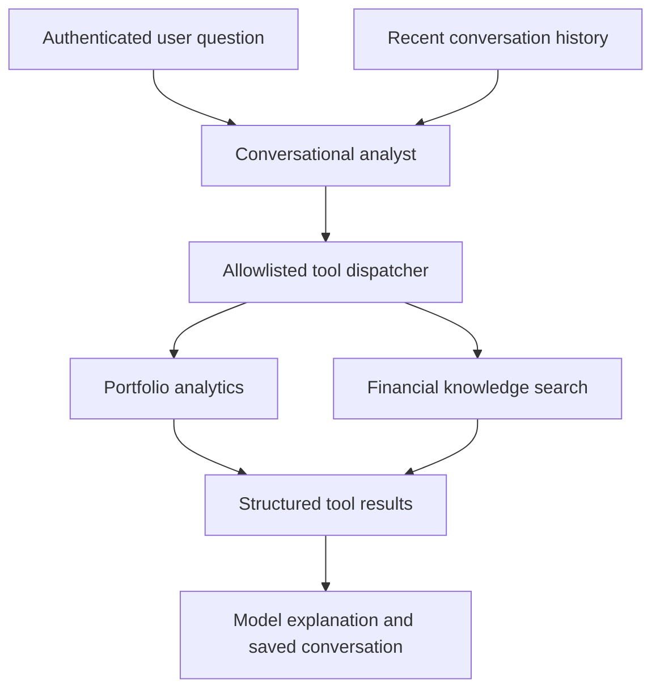

# InvestMind AI architecture

## Overview

InvestMind AI combines deterministic portfolio analytics with structured AI
reports, persistent conversations, controlled tool calling and financial
knowledge retrieval. Backend services calculate the financial metrics; the
language model explains available results and reference material.

Two AI paths serve different purposes:

| Path | Input and behavior | Saved result |
| --- | --- | --- |
| Portfolio report | Deterministic context supplied to a schema-constrained generation request | Report, context snapshot, evaluation and processing state |
| Conversational analyst | User question, recent conversation history and allowlisted tool results | Conversation and user/assistant messages |

## Deterministic analytics

Python services calculate portfolio composition, concentration, performance,
risk, diversification, attribution and risk-adjusted performance. TWR and
money-weighted calculations follow the implemented portfolio conventions and
may be unavailable when the required inputs or solvability conditions are absent.

Market quotes and historical prices are separate data paths. Quotes use a Redis
cache; historical closing prices are persisted in PostgreSQL. A successful quote
request does not populate historical price records.

The current valuation model treats purchases as contributions and sales as
withdrawals; it does not maintain a separate cash account. Annualized metrics use
a conservative availability guard for unsupported transaction-only return
intervals. The detailed behavior is recorded in the
[functional validation review](functional-validation-review.md).

## Structured reports

The report task builds a deterministic context snapshot, requests structured
output, evaluates the response and persists the result. Processing states include
pending, processing, completed, rejected and failed.

The report schema includes analysis sections, limitations, unavailable sections
and evidence entries referencing exact scalar paths in the supplied context.
The generation instructions prohibit replacing backend calculations or inventing
missing metrics. Null metrics remain unavailable even when other metrics in the
same section are available.

Saved reports are snapshots. Changes to prices, holdings, instructions or runtime
configuration do not rewrite previous reports. Validation of a new release or
configuration requires a new report.

The task stores fixed public error messages and logs diagnostic codes. The
[output-limit guide](demo-report-output-limit.md) describes the observed token
budget failure and its runtime adjustment. An automated evaluation pass indicates
compliance with the implemented checks, not an independent audit of every claim.

## Conversational tool calling



Portfolio tools include `get_portfolio_performance`, `get_portfolio_risk`,
`get_portfolio_composition` and `get_portfolio_diversification`. Financial knowledge
is exposed through `search_financial_knowledge`.

Django resolves the authenticated user's portfolio and enforces ownership. The
model does not supply a portfolio identifier to these tools. Tool names and
arguments are validated, and orchestration has bounded tool-call rounds.

Conversation history supports follow-up questions. Current financial values must
come from backend data rather than an earlier assistant message.

## Knowledge ingestion and retrieval

The curated Markdown corpus is stored in `portfolios/ai/knowledge_base/` and
covers returns, risk, diversification, concentration and analytical limitations.
It contains explanatory material rather than account holdings or live quotes.

Ingestion performs heading-aware, token-bounded chunking with overlap, generates
OpenAI embeddings, and stores documents and chunks in PostgreSQL with pgvector.
SHA-256 content hashes identify unchanged documents so that repeat ingestion
does not request new embeddings for the same content.

Embeddings are obtained before the database update transaction for each document.
A provider failure at that point leaves that document's previous stored chunks
intact. The full directory is not an all-or-nothing ingestion transaction: earlier
documents may already have been updated when a later document fails.

Retrieval embeds the user query and orders active chunks with embeddings by cosine
distance. The default result count is three; the implementation permits up to ten.
Returned records include document and section references, content, distance and
similarity. Source references support inspection of the explanation; retrieval
does not guarantee that every returned passage is relevant or complete.

## Management commands

Run these commands from the repository root against the local Docker environment:

```bash
docker compose exec web python manage.py ingest_knowledge_base
docker compose exec web python manage.py evaluate_rag --top-k 3
```

Ingestion and semantic retrieval evaluation call the embedding provider and
require a configured key. Retrieval evaluation uses curated expected sources and
reports Hit@K and mean reciprocal rank (MRR).

The `evaluate_ai_report` command generates and evaluates a report for a supplied
portfolio ID. It makes a live generation request and prints report content; it
should be run only for an explicitly selected demo portfolio. It is a separate
diagnostic path from the asynchronous report task.

For AWS, execute management commands inside the deployed web service using the
Compose prefix documented in [AWS operations](aws-demo-operations.md).

## Security boundaries

- Authenticated access and portfolio ownership checks are enforced by Django.
- Tools are read-only and allowlisted, with validated function arguments.
- Retrieved passages are treated as reference data, not executable instructions.
- The model receives instructions to disregard commands embedded in retrieved
  content and to explain unavailable data rather than infer it.
- Provider, retrieval and orchestration failures have explicit error paths.
- API keys remain outside Git, image layers and public report error messages.

These controls reduce exposure and are covered by tests; they do not establish
complete resistance to prompt injection or other model failures.

## Validation

Tests cover client responses, report schemas and evaluation, report tasks,
ownership, tool execution, conversation persistence, chunking, embeddings,
ingestion, retrieval and RAG evaluation. External provider calls are mocked where
appropriate; PostgreSQL/pgvector retrieval also has integration coverage.

Live AWS validation confirmed five indexed documents, 31 embedded chunks,
relevant retrieval results, tool-assisted explanations and asynchronous report
generation. These counts describe the recorded demo, not fixed requirements for
every installation. Current validation evidence and remaining limitations are
documented in the [functional review](functional-validation-review.md).
